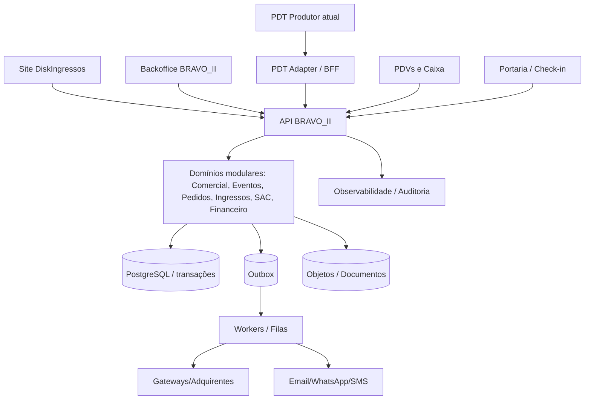

# 03 — Arquitetura técnica do BRAVO_II

## Escolha recomendada: monólito modular antes de microserviços
O ponto de partida é um **backend NestJS/Node.js com TypeScript** dividido em módulos de domínio claramente isolados, **PostgreSQL** como fonte transacional, **Redis + filas de trabalho** para tarefas assíncronas e **armazenamento de objetos S3-compatível** para arquivos. Frontends: **Next.js + React + TypeScript**, com componentes compartilhados e layout pt-BR. Monorepo com **pnpm workspaces + Turborepo** (ou equivalente existente), linters, testes e CI. Avaliar versões de dependências no momento da criação, fixar lockfile e não assumir versões não verificadas.

Motivos: ingressos, assentos, pedidos e financeiro exigem transações consistentes, não chamadas distribuídas improvisadas. Evita custo e fragilidade de dezenas de serviços no início. APIs, eventos de domínio, outbox e contratos tornam eventual extração de serviços possível.

## Monorepo objetivo
```text
bravo-ii/
├── apps/
│   ├── backoffice/             # Next.js: ERP interno
│   ├── pdt-adapter/            # BFF/API para integração com PDT atual (não substituí-lo de início)
│   ├── pdv/                    # PWA/desktop de PDV com operação autorizada
│   ├── api/                    # NestJS: monólito modular
│   │   └── src/
│   │       ├── modules/
│   │       │   ├── identity/    # IAM e escopos
│   │       │   ├── producers/   # ORG
│   │       │   ├── customers/   # CRM PF
│   │       │   ├── commercial/  # B2B/contratos
│   │       │   ├── events/      # EVT
│   │       │   ├── inventory/   # INV
│   │       │   ├── orders/      # ORD
│   │       │   ├── tickets/     # TKT
│   │       │   ├── payments/    # PAY
│   │       │   ├── point-of-sale/
│   │       │   ├── service-desk/
│   │       │   ├── coupons/
│   │       │   ├── refunds/
│   │       │   ├── pricing-fees/
│   │       │   ├── finance/
│   │       │   ├── marketing/
│   │       │   ├── messaging/
│   │       │   ├── gate-control/
│   │       │   ├── reporting/
│   │       │   └── governance/
│   │       ├── common/         # somente infraestrutura: erros, auth, config, tracing
│   │       └── bootstrap/
│   └── workers/                # e-mails, webhooks, outbox, reconciliação
├── packages/
│   ├── ui/                     # design system pt-BR
│   ├── contracts/              # DTOs, validação Zod / OpenAPI / esquema de eventos
│   ├── sdk/                    # cliente tipado de APIs
│   ├── config/                 # regras compartilhadas de compilação
│   ├── telemetry/              # logs, métricas, traces
│   └── testing/                # fixtures de testes isoladas
├── database/
│   ├── migrations/             # versionadas, testadas, reversibilidade documentada
│   └── seeds/                  # apenas dados técnicos mínimos; nunca dados fictícios de negócio
├── infrastructure/             # Docker Compose dev, CI, cloud e secrets references
├── docs/                       # ADRs, catálogo de módulos e playbooks
├── GEMINI.md
├── AGENTS.md
└── pnpm-workspace.yaml
```

## Isolamento de módulos
- Um módulo **não lê diretamente** repositório/tabela privada de outro. Chama serviço de aplicação tipado, consulta autorizada ou consome evento.
- Cada módulo expõe `commands`, `queries`, `events`, `policies`, `repository interfaces`, `transport adapters` e testes de contrato.
- Um mesmo endpoint público pode orquestrar múltiplos domínios via aplicação, nunca colocar regras críticas no controlador ou tela.
- Processos assíncronos usam **outbox transacional** + consumidores idempotentes; reprocessamento seguro com chaves únicas.
- Módulos de leitura/BI recebem projeções; **saldo oficial** vem do ledger, jamais de somas alternativas do frontend.

## Arquitetura em execução


## Persistência e integridade
- IDs internos UUID/ULID; chaves de negócio legadas em tabela de mapeamento; índice único nos campos críticos.
- ACID em `reservar disponibilidade`, `emitir ingresso`, `lançar contabilidade auxiliar` e `realizar estorno lógico`. Para comunicação externa, usar estado pendente e evento/outbox.
- Estoque por assento com restrição única de ocupação ativa e controle concorrente; para setores sem assento, capacidade/contadores validados na transação.
- Dados monetários em `NUMERIC(18,2)` ou centavos inteiros; nunca ponto flutuante em cálculos financeiros.
- Data/hora armazenada em UTC, exibida em fuso do evento/usuário e pt-BR; registrar fuso do evento para publicação e operação.
- Retentativas com backoff, dead-letter queue, idempotency keys, timeout e monitoramento.
- Nenhuma credencial API no bundle do navegador; integração externa executada por backend.

## Escalabilidade
Medir primeiro: vendas/minuto, reserva concorrente, latência de checkout, throughput de validação, webhooks atrasados, filas, tempo de conciliação e relatórios. Indexação, cache de leitura, réplicas e particionamento por necessidade observada. Separar microserviço (ex.: checkout) apenas com contratos e testes maduros.

## Ambientes e entrega
`local → testes automatizados → Preview/Homologação → staging com integrações sandbox → produção com autorização`. Infraestrutura com migrations reversíveis, feature flags, observabilidade, backups restauráveis e rollback de aplicação. **Nenhuma operação de pagamento/estorno/repasses real em ambiente não homologado.**

## Não fazer
- Não construir 20 frontends independentes com bases duplicadas.
- Não colocar cálculo financeiro no React, na query de dashboard ou no gateway de pagamento.
- Não registrar CPF ou token de cartão em logs.
- Não criar telas com valores fictícios para aparentar integração.
- Não publicar ou substituir SIGE/PDT/site em produção automaticamente.
- Não promover evento a publicado sem estados/aprovações aplicáveis.
