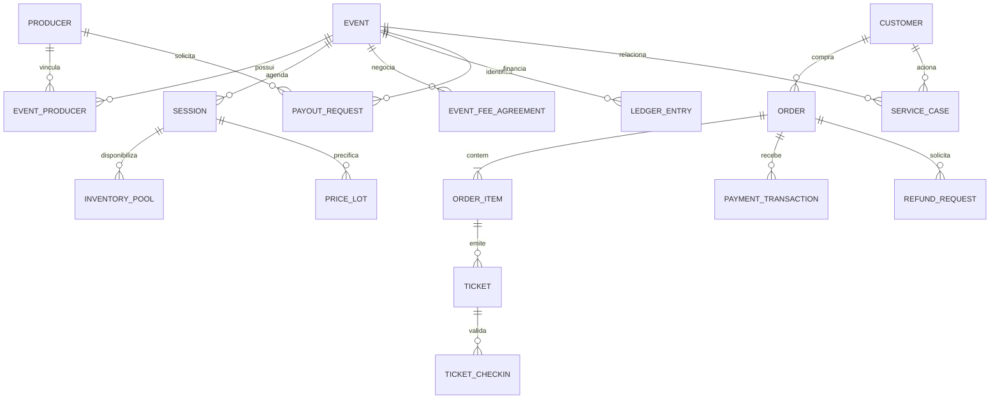

# 04 — Modelo lógico de dados e regras obrigatórias

## Domínios e entidades principais

### Identidade e organização
`User`, `Role`, `Permission`, `RoleGrant`, `UserEventScope`, `UserProducerScope`, `AuthSession`, `MfaFactor`, `ApprovalPolicy`, `ApprovalTask`, `AuditRecord`, `ExportAudit`.

### Pessoa jurídica e Comercial
`Producer` (PJ, CNPJ, razão social, nome fantasia, contatos, endereço, representantes, status de verificação), `ProducerDocument`, `ProducerBankAccountToken` (dados bancários protegidos), `ProducerContact`, `EventProducer` (event_id, producer_id, papel principal/secundário e percentuais contratuais, se aplicável), `CommercialProposal`, `Contract`, `EventFeeAgreement`, `FeeAgreementVersion`, `FeeApproval`.

### Clientes e consentimentos
`Customer` (PF com dados pertinentes à finalidade e status), `CustomerAddress`, `CustomerContact`, `CustomerVerification`, `ConsentRecord` (finalidade/canal/base/versão/data/fonte/revogação), `CustomerMergeHistory`, `PrivacyRequest`.

### Evento e inventário
`Venue`, `Event`, `EventGroup`, `Session`, `EventApproval`, `EventPublication`, `EventDocument`, `EventMedia`, `Area`, `Sector`, `Seat`, `TicketCategory`, `PriceLot`, `PriceVersion`, `SalesChannel`, `EventChannel`, `InventoryPool`, `InventoryHold`, `SeatBlock`, `InventoryAdjustment`, `EventSuspensionCase`.

### Pedidos e ingressos
`Order`, `OrderItem`, `OrderAdjustment`, `OrderChannel`, `CheckoutSession`, `PaymentIntent`, `PaymentTransaction`, `PaymentProviderEvent`, `Ticket`, `TicketCredential`, `TicketStatusHistory`, `TicketTransfer`, `TicketCheckin`, `TicketDelivery`, `CancellationRequest`.

### Cupons, cortesia, SAC
`CouponCampaign`, `CouponCode`, `CouponRule`, `CouponRedemption`, `CourtesyQuota`, `CourtesyIssue`, `ServiceCase`, `ServiceMessage`, `ServiceAttachment`, `SlaPolicy`, `SlaBreach`, `Incident`, `Problem`, `KnowledgeArticle`, `ServiceChange`.

### Financeiro e estorno
`LedgerAccount`, `LedgerEntry`, `LedgerPosting`, `MoneyMovement`, `Receivable`, `Payable`, `Settlement`, `EventBalanceProjection`, `Acquirer`, `AcquirerRate`, `PaymentBrand`, `InstallmentPlan`, `EventFeeSnapshot`, `TransferRequest`, `PayoutRequest`, `AdvanceRequest`, `RefundRequest`, `RefundAttempt`, `RefundProviderEvent`, `BankReconciliation`, `ChargebackCase`, `Expense`, `Withholding`.

### Campanhas e portais
`Campaign`, `CampaignTouch`, `UtmAttribution`, `MarketingProviderConnection`, `Audience`, `AudienceMembership`, `MessageTemplate`, `MessageCampaign`, `MessageDelivery`, `ProducerPortalGrant`, `ProducerPortalRequest`, `IntegrationCredential`, `IntegrationDelivery`, `OutboxEvent`, `InboxProcessedEvent`.

## Modelo relacional essencial

## Regra central da Taxa Disk
A Taxa Disk é negociada **por evento**, nunca aplicada automaticamente a todos os eventos de um produtor. A versão aprovada deve conter:

- `event_id`, `agreement_version`, `valid_from`, `valid_until`, `approved_by`, `approved_at`, `approval_reference`;
- `calculation_type`: `PERCENTAGE` ou `FIXED`;
- `base`: valor nominal do ingresso (regra definida); porcentagem com precisão decimal ou valor fixo em centavos;
- `scope`: evento e eventuais exceções contratuais por categoria, lote, sessão ou canal **somente quando expressamente aprovadas**;
- `payer`: quem suporta o valor conforme contrato (sem presumir exibição/repasse ao cliente); `tax_treatment` parametrizado;
- `visibility`: **interno Disk**, nunca incluído em payloads do PDT/relatórios de produtor sem autorização comercial expressa e revisão da política;
- `snapshot`: regra efetivamente aplicada, guardada no item vendido, sem recomputar com a regra mais recente.

**Exemplo puramente matemático, não valor de negócio:** preço nominal `P`, percentual `r` ou fixo `f`; `taxa_disk = round(P*r, 2)` ou `taxa_disk = f`. Ajustes de desconto, meia-entrada, reembolso e tributos exigem política específica. Desacoplar `MDR`, `parcelamento`, `comissão PDV`, `spread`, `rebate` e `advanced` em rubricas distintas.

## Fluxo financeiro fundamental
O valor integral de uma venda processada em nome da Disk ingressa na conta da Disk, mas **nem todo recebimento é receita da Disk**. Acompanhamento mínimo:

1. **Bruto vendido**: valor nominal dos ingressos, taxas cobradas, descontos e composição do pedido.
2. **A receber**: autorizações/capturas pendentes de liquidação por adquirente.
3. **Efetivamente recebido**: liquidação confirmada, conciliada a pedido/transação.
4. **Receita da Disk**: Taxa Disk e outras rubricas próprias reconhecidas conforme regra contratual/contábil.
5. **Obrigação com produtor/evento**: valores devidos, ajustes, retenções e encargos previstos.
6. **Disponível para repasse**: saldo elegível após recebimentos liquidados, regras de liberação, reservas, despesas, estornos e antecipações.
7. **Repasse executado**: pagamento bancário confirmado + conciliação.

Implementar razão auxiliar **de partidas dobradas**, trilha de origem e lançamentos de reversão. Cada lançamento tem `source_type`, `source_id`, `event_id`, `producer_id` quando aplicável, `currency`, débito/crédito, referência externa e chave idempotente. Não alterar lançamentos fechados nem somar valores por status visual para determinar saldo.

## Spread / Rebate / Advanced
Esses três nomes são necessidades de negócio, **não especificações de cálculo**. Criar motor de regras e UI de configuração com campos/validações, mas deixar qualquer execução financeira desabilitada até serem definidos: fórmula, base de cálculo, beneficiário, origem do dinheiro, eventos contábeis, condições de pagamento, aprovação, limites, contratos e tratamento de cancelamento/estorno.

## Ticket público de oito dígitos
- O código deve respeitar `^[0-9]{8}$` (preservar zeros iniciais); identificador interno independente (UUID/ULID).
- Espaço matemático de **100 milhões** de combinações; definir unicidade **global** como preferência para reduzir ambiguidades em SAC/PDV, conferir volume histórico e evitar colisão com séries legadas.
- Gerar por alocador transacional/único (ou aleatoriedade criptográfica com índice único e retry limitado), nunca por concatenação previsível de dados pessoais.
- Código não é credencial de entrada. Criar `ticket_id`, `credential_id`, `token_version`, assinatura criptográfica/segredo e verificação do estado corrente.
- Reemissão/transferência invalida credenciais anteriores quando a política exigir; preservar código público ou gerar outro conforme política expressa, mantendo relação no histórico.
- Venda e reserva sujeitas à sincronização; não emitir tickets após pagamento rejeitado ou antes de conclusão autorizada.

## PDV e inventário
- Inventário lógico de `event_id/session_id/sector_id/seat_id` com ocupação consistente por múltiplos canais.
- `InventoryHold` expira e liberta capacidade automaticamente; confirmação de pagamento consome estoque de modo transacional.
- Bloqueio por produtor/operador com motivação, prazo e permissão específica; desbloqueio não pode reabrir assento já vendido.
- Conexão intermitente de PDV requer fila segura e política explícita; **não vender offline inventário compartilhado sem quotas pré-alocadas e reconciliação de idempotência**.

## Evento cancelado ou adiado
Registrar caso operacional distinto de simples cancelamento de ingresso. Congelar emissão/alterações incompatíveis, apurar audiência e obrigações, comunicação, política de reembolso, aprovações e conciliação. A decisão comercial/legal sobre manter ingressos em sessão remarcada deve ser configurável e documentada. Ingresso validado tem regra diferente de ingresso ainda não utilizado.
