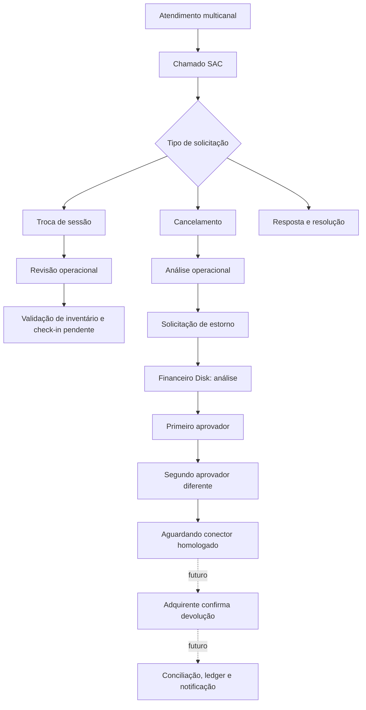

# BRAVO_II — Pacote 10: Arquitetura aprovada

## Objetivo
Um único fluxo de atendimento/solicitações, com atendimento SAC e pós-venda separados de execução financeira, persistência em PostgreSQL, roles no servidor e auditoria. Complementa o Pacote 09 (checkout/PDV) sem sobrescrever os 149 itens catalogados de Financeiro/RH.

## Módulos

### 10.1 — Atendimento SAC (NestJS/Next.js)
- Central de chamados, busca, categoria, prioridade, canal de origem e protocolo único.
- Interações internas e respostas registradas, histórico imutável de mensagens, status controlados por máquina de estados, responsável e fila.
- Políticas de SLA versionadas por categoria e prioridade. Temporizador em **minutos corridos**; calendário de horários úteis/feriados e alertas recorrentes **não implementados**.
- Equipes, filas e membros; guarda de equipe para atribuição.
- Incidentes ITIL/incident/major, problemas e base de conhecimento interna (artigo rascunho/publicado), coleta de CSAT interno. Conexão real com e-mail/telefone/chat/WhatsApp requer plugins e homologação.
- Indicadores originados de consultas reais do PostgreSQL.

### 10.2 — Pós-venda / trocas
- Solicitação vinculada a `BravoSaleOrder` e `BravoIssuedTicket`, referência explícita para `BravoEventSession` e `BravoPriceLot` de destino.
- Revisão por pessoa distinta, qualificação de preço, status para aguardar pagamento de diferença, impedimento de operação silenciosa.
- Troca definitiva **não executável nesta versão**: portaria/check-in e inventário numerado não homologados. Os modelos já reservam vínculo antigo→novo (`BravoTicketReplacement`).
- Regras futuras: trava do ingresso original, check-in online comprovado, mesmo evento, sessão futura, lote ativo, estoque atômico, preço igual ou liquidação comprovada, evento publicado, numeração 8 dígitos e auditoria.

### 10.3 — Cancelamentos
- Solicitações por ingresso, pedido e evento e revisão operacional independente.
- Solicitação **não** modifica pedido pago, ingressos ou valor financeiro por si só.
- Planejamento de lote de estornos do evento somente com `BravoEventChangeCase` formal `CANCELAMENTO`, `APROVADO` operacional e financeiro; soma projetada líquida de solicitações de estorno não reprovadas, calculada em um momento específico, sem executar devolução. Processamento em lote, comunicação e reconciliação item a item ainda não estão implementados.

### 10.4 — Estornos e Financeiro Disk
- Solicitação de devolução de pedido `PAGO` com comprovante `BravoPaymentConfirmation` e valor inteiro em centavos.
- Dedução do limite total de devoluções ativas para impedir pedidos além da venda confirmada; serialização com trava do pedido.
- Revisão financeira; dupla aprovação individual com passos 1 e 2, aprovadores distintos e diferentes do solicitante.
- A segunda aprovação registra `BRAVO_REFUND_APPROVED_HOLD` no Outbox para integração futura; `externalExecutionAllowed:false`.
- **Não existem rotas de execução do estorno**; o adaptador futuro deve autenticar webhook e registrar prova externa antes de indicar `CONCLUIDO`.
- Consulta de impacto mostra projeções de valores, não pagamentos executados.
- Etapas `AGUARDANDO_CONECTOR → PROCESSANDO → CONCLUIDO` reservadas para uma versão posterior homologada do worker.

## Fluxos

## Divisão técnica
- `packages/domain-p10` regras puras de SLA, estado, aprovação, limites e pré-validação da troca.
- `apps/api/src/modules/pacote10` controllers e serviços operacionais, guard central, transações e audit.
- `prisma/schema.prisma` fonte única dos modelos.
- `apps/backoffice/src/app/(erp)` telas com dados do banco e permissões por perfil. O backend também verifica cada role.
- `reference/` catálogo original preservado.

## Governança/segurança
- Cookies HttpOnly, CSRF e sessão central herdados do P07/09.
- Proteção de leitura pelo papel; operador do SAC não aprova estorno financeiro.
- `ADMIN` não substitui `FINANCEIRO_DISK` nas aprovações bancárias.
- Todos os IDs em APIs mutáveis são validados; cada troca/estorno exige integridade referencial do pedido.
- A definição concreta de retenção de dados, anonimização, criptografia de anexos, consentimento multicanal e política de acesso por produtor fica pendente de avaliação LGPD antes de produção.
- Sem execução de cobranças, cancelamento de ingressos pagos, movimentação de caixa ou estorno externo neste pacote.
