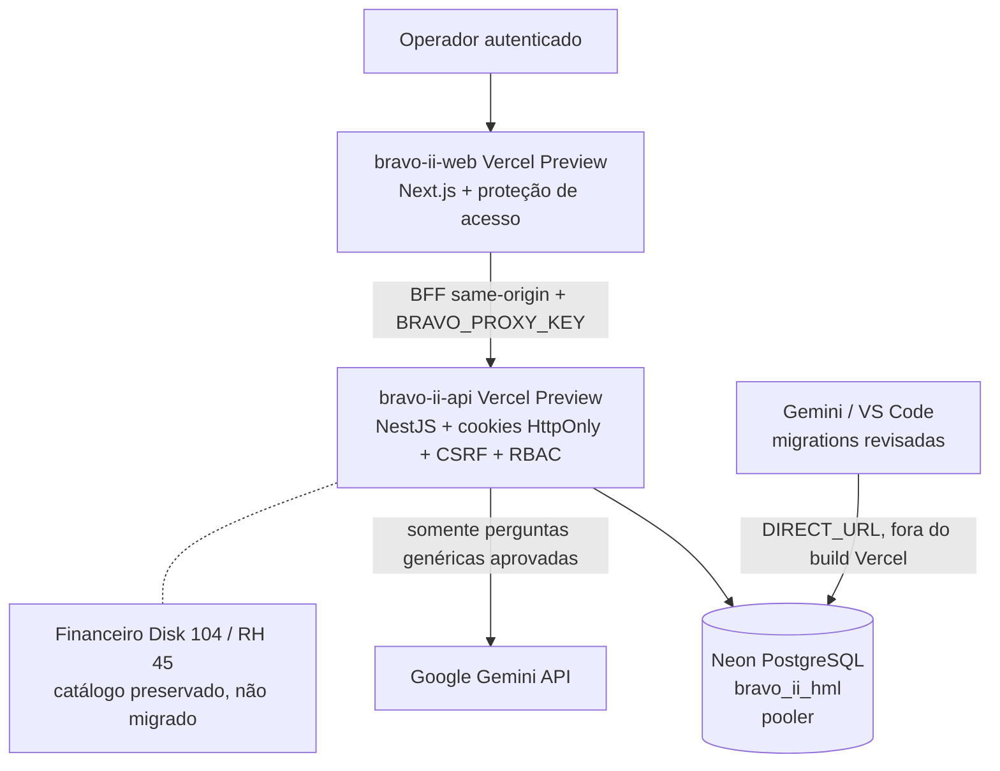

# BRAVO_II — Arquitetura final Vercel + Neon + Gemini

## Objetivo e status real
- **Ponto de partida:** base integrada dos Pacotes 01 a 12, sem reescrever P06–P10.
- Backoffice `apps/backoffice` (Next.js) em `bravo-ii-web` na Vercel **Preview**.
- Portal do Produtor `apps/producer-portal` (Next.js) em `bravo-ii-producer-portal` na Vercel **Preview**.
- API `apps/api` (NestJS) em `bravo-ii-api` na Vercel **Preview**.
- PostgreSQL no Neon, banco **`bravo_ii_hml` exclusivo para homologação** (11 migrations SQL `0001`..`0011` e 55 modelos Prisma). O ERP mantém seu único `prisma/schema.prisma`.
- Gemini Developer API como IA de **orientação interna**: apenas leitura, sem acesso a dados pessoais ou comandos de alteração.
- Financeiro Disk e RH: os **149 itens do inventário original (104+45)** permanecem preservados em `reference/`, além das 96 telas operacionais do Financeiro Disk conectadas à migration `0011`.

## Fronteiras e proteção
1. O navegador acessa somente o Backoffice por HTTPS; `BRAVO_API_URL`, `BRAVO_PROXY_KEY`, `GEMINI_API_KEY` e `DATABASE_URL` nunca possuem prefixo `NEXT_PUBLIC_`.
2. O BFF Next.js (`/v1/*`) encaminha chamadas para NestJS com `X-Bravo-Proxy-Key`. A API recusa requisições que não incluírem a chave. Mesmo com a chave, a API exige sessão/RBAC, Origin e CSRF em mutações.
3. Ative **Deployment Protection** para Backoffice e API. Se a API estiver protegida, o BFF precisa de `BRAVO_API_VERCEL_BYPASS_TOKEN` configurado apenas no projeto Backoffice; este token permite atravessar a camada de proteção Vercel, não substitui login nem a chave BFF.
4. A API acessa o banco Neon pelo host `-pooler`. Migrations são executadas por operador autorizado com `DIRECT_URL` (sem `-pooler`), com verificação de banco homologado e revisão humana.
5. A chave Gemini é restrita ao projeto `bravo-ii-api` em Preview; `BRAVO_GEMINI_ENABLED` inicia `false`. Política de consulta por áreas (SAC, Comercial, Eventos, Financeiro, RH e Geral) e usuário autenticado.
6. O usuário fornece somente uma pergunta genérica, nunca cliente, pedido, documento, extrato, funcionário ou base exportada. Nenhum registro do ERP é enviado automaticamente ao Gemini. O backend recusa padrões comuns de dados pessoais e bancários, limita o tamanho, audita metadados e aplica cota compartilhada via PostgreSQL.
7. A IA não possui ferramentas/calls para editar qualquer módulo. **Nenhuma aprovação financeira, estorno, venda, publicação, check-in ou substituição de ingresso é autorizada pela IA.**
