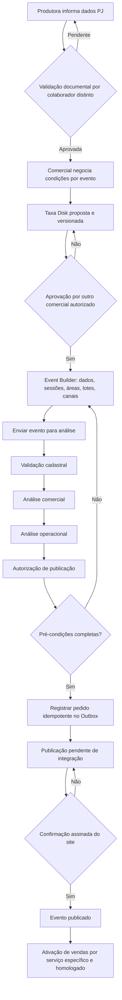

# Jornada fim a fim: Comercial → Eventos → Publicação

## Status de evento
`RASCUNHO` → `EM_ANALISE` → `APROVADO` → `PUBLICACAO_SOLICITADA` → `PUBLICADO`.
`REPROVADO` exige justificativa e revisão; revisões após aprovação/publicação exigem um pedido de alteração versionado, não PATCH direto. `CANCELADO`, `ADIADO`, `SUSPENSO`, `ENCERRADO` têm políticas/integrações específicas ainda a desenvolver.

## Quatro pareceres obrigatórios e separados
- **CADASTRAL:** produtora principal válida, documentação, representação, vínculo.
- **COMERCIAL:** existe Taxa Disk com aprovação, vigência e referência contratual.
- **OPERACIONAL:** sessões, capacidade, lotes/valores, canais, áreas e regras de venda.
- **PUBLICACAO:** valida imagens, políticas públicas, classificação etária e pré-requisitos; autorização é humana separada da efetiva publicação externa.

## Estados da taxa
`PROPOSTA` → `APROVADA` ou `REPROVADA`; versões aprovadas anteriores permanecem como histórico de vigência, sem retroatividade. O motor de ingressos no futuro escolherá a **última versão aprovada cuja vigência já começou** no momento de cada venda. O valor calculado e a versão serão salvos no item vendido, sem recálculo retroativo.

## Prevenção de erros
- Não permitir alterar evento submetido/confirmado por edição livre.
- Não permitir produtor com documento pendente aprovar evento.
- Não permitir que o mesmo ator submeta e aprove o próprio evento.
- Não permitir taxa comercial proposta e aprovada pelo mesmo usuário.
- Não publicar automaticamente quando clicar em Aprovar.
- Não publicar nem ativar checkout enquanto publicação depender do site.
- A referência de produtor é ID canônico do Core, não cadastro duplicado no Financeiro.
