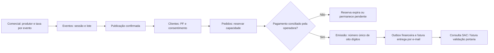

# Arquitetura do Pacote 08 — Pedido e ingresso

## Fluxo entre os departamentos

**Somente o ramo até pedido reservado possui implementação de preparação em homologação. O ramo de pagamento verificado permanece tecnicamente bloqueado**, pois ainda não foi habilitado um adaptador de operadora com webhook assinado e confirmação de liquidação. O método interno de emissão está definido mas exige essa integração futura e não é exposto por HTTP.

## Contrato da reserva

- O cadastro do consumidor deve existir e ser pessoa física com CPF validado.
- O evento precisa estar com `status=PUBLICADO`, acompanhado de sessão `ATIVA`, lote `ATIVO`, janela de vendas válida e canal habilitado.
- No Pacote 08 a reserva de lote numerado é **recusada** até existir uma alocação concorrente por assento/sessão.
- O pedido reserva de 1 a 10 ingressos do **mesmo lote**, sem múltiplos itens no mesmo pedido. Evolução multilot prevista.
- Preço unitário e total são armazenados em centavos, no momento da reserva, imutáveis enquanto a reserva existe.
- `idempotencyKey` é UUID por intenção de reserva: repetição idêntica retorna o mesmo pedido; uso da chave para intenção diferente gera conflito.
- A capacidade é alterada com SQL `UPDATE` condicional atômico e transação `SERIALIZABLE`.
- O pedido nasce `RESERVADO`, vence em quinze minutos, pode ser cancelado se não pago e não cria ingresso.
- Reservas vencidas exigem processamento de liberação. Existe comando interno de limpeza; o agendador confiável de produção é requisito posterior.

## Cadastro de pessoa física e LGPD

- CPF verificado matematicamente, mas armazenado somente como HMAC-SHA256 com pepper privado para deduplicação. São preservados quatro últimos dígitos apenas para conferência, com acesso restrito.
- Nome, e-mail e telefone são persistidos para a operação de atendimento. Endereço e nascimento são opcionais na primeira etapa; obrigatoriedade futura exige finalidade e base legal.
- Consentimento opcional para campanhas é independente do cadastro da compra; marketing não pode presumir autorização.
- Exigem-se política de retenção, controle de acesso, backup cifrado, direitos do titular, resposta a incidente e proteção de dados antes de operar com dados reais.

## Comunicação com Financeiro Disk

- O evento conserva a Taxa Disk negociada por evento, disponível apenas para usuários internos autorizados.
- Pedido `RESERVADO` NÃO representa venda liquidada, dinheiro recebido ou saldo do produtor.
- Somente após prova de pagamento haverá `BRAVO_ORDER_PAID` em `BravoOutbox`, pronto para **futura** integração ao ledger e conciliação.
- Não é criado lançamento contábil nem repasse por reservar.
- Pedidos cancelados depois da liquidação exigirão fluxo separado SAC + aprovação Financeiro + integração com gateway.

## Sequência de oito dígitos

- Contador global `BravoTicketSequence` é incrementado na transação de emissão, gerando `00000001` a `99999999`.
- `BravoIssuedTicket.number` possui índice único.
- Número não é QR, não serve como senha de acesso nem permite validação de ingresso sozinho.
- Não reutilizar número emitido, mesmo em cancelamento/estorno.

## Conexões pendentes

- Venda online ao site `diskingressos.com.br` com tokenização e checkout, sem expor infraestrutura interna.
- PDV/bilheteria com terminal autorizado, estoque compartilhado, eventos offline e reconciliação.
- Gateway com validação de assinatura oficial, idempotência de callbacks, estorno, antifraude e disputa.
- Geração de PDF/QR seguro e envio de e-mail com retries/consentimento.
- Reserva de poltrona e bloqueios por sessão, anti-dupla venda.
- Cupons, cortesias e troca de sessão.
- Portaria, check-in, auditoria de validações, LGPD e SAC ITIL/SLA.
